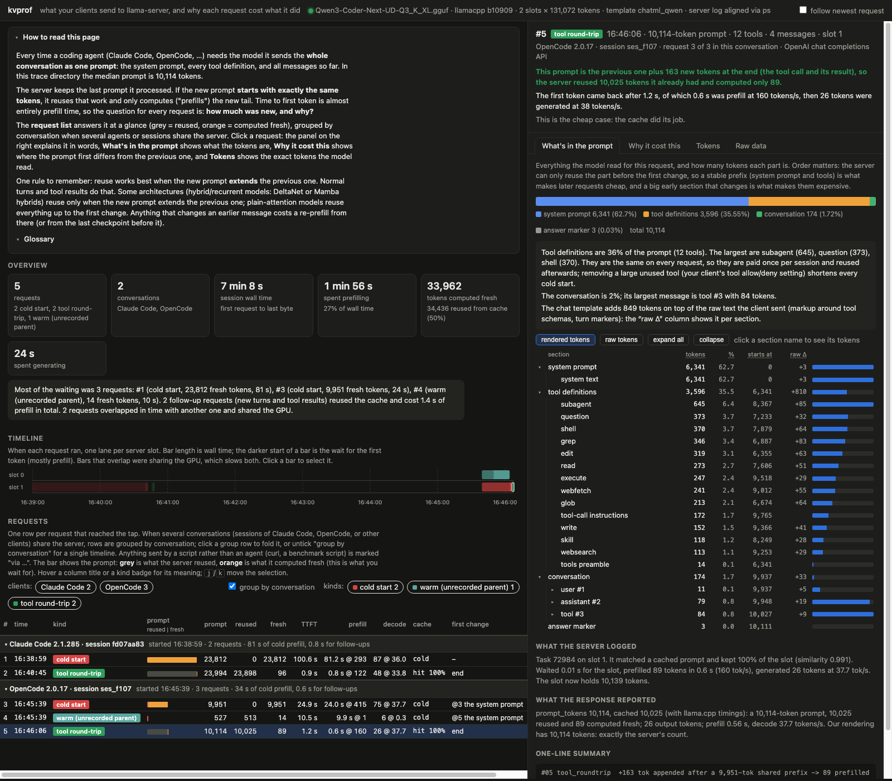

# kvprof

**Why did llama-server re-prefill my prompt?**

kvprof is a prompt-cache profiler for [llama.cpp](https://github.com/ggml-org/llama.cpp)'s `llama-server`.
It records the requests your client sends (Claude Code, OpenCode, or anything speaking the Anthropic Messages or
OpenAI chat-completions API), renders each one through the server's own chat template, tokenizes it, maps every
token to a section of the prompt (system text, each tool definition, each message block), diffs consecutive
prompts token by token, and reconciles all of that with the server's own prefill numbers from its log. For each
request you get: what changed since the previous prompt, where the prompt first diverged, how much the server
reused and how much it had to compute again, and what that cost in seconds.

```
#01 cold            23,812-tok prompt (system 1,357 / tools 19,501 / messages 2,951) -> 23,812 prefilled in 81.15 s @ 293 t/s (slot 1, LRU); decode 87 tok @ 36.0 t/s; TTFT 100.6 s; exact
#02 tool_roundtrip  +182 tok appended after a 23,812-tok shared prefix -> 96 prefilled in 0.79 s @ 122 t/s (slot 1, f_keep 1.000); decode 48 tok @ 33.8 t/s; TTFT 0.9 s; exact
#03 cold            9,951-tok prompt (system 6,341 / tools 3,596 / messages 11) -> 9,951 prefilled in 23.97 s @ 415 t/s (slot 1, LRU; concurrent with #0004); decode 75 tok @ 37.7 t/s; TTFT 24.9 s; exact
#05 tool_roundtrip  +163 tok appended after a 9,951-tok shared prefix -> 89 prefilled in 0.56 s @ 160 t/s (slot 1, f_keep 1.000); decode 26 tok @ 37.7 t/s; TTFT 1.2 s; exact
```

`exact` means kvprof's rendering of the prompt has exactly the token count the server reported, so the section
boundaries and the divergence point are the server's, not an estimate.



Stdlib-only Python (3.11+), no build step for the GUI.

## Install

```sh
uv tool install kvprof        # or: pipx install kvprof
# from a checkout:
uv tool install .
```

## Quickstart

Start llama-server as usual (the examples assume its default `http://127.0.0.1:8080`) and write its log to a
file, e.g. `llama-server ... --log-file server.log` or `llama-server ... 2> server.log`.

```sh
kvprof doctor --upstream http://127.0.0.1:8080 --server-log server.log   # does the server expose what kvprof needs?
kvprof tap --upstream http://127.0.0.1:8080                               # listens on 127.0.0.1:8081, records into ./.kvprof/
```

**Claude Code** (in another terminal):

```sh
ANTHROPIC_BASE_URL=http://127.0.0.1:8081 ANTHROPIC_AUTH_TOKEN=local ANTHROPIC_MODEL=<model alias> claude
```

`<model alias>` is what llama-server calls the model (`kvprof doctor` prints it; set it with `llama-server --alias`).

**OpenCode**: add a project `opencode.json` that points the provider at the tap:

```json
{
  "$schema": "https://opencode.ai/config.json",
  "provider": {
    "llamacpp": {
      "npm": "@ai-sdk/openai-compatible",
      "options": { "baseURL": "http://127.0.0.1:8081/v1", "apiKey": "local" },
      "models": { "<model alias>": {} }
    }
  }
}
```

**Any OpenAI client**: `OPENAI_BASE_URL=http://127.0.0.1:8081/v1`. For usage numbers in streamed responses the
client should send `stream_options: {"include_usage": true}` (OpenCode does); without it kvprof falls back to the
server log and llama.cpp's `timings`.

Then look at what happened:

```sh
kvprof analyze --upstream http://127.0.0.1:8080 --server-log server.log          # one line per request
kvprof analyze ... --dump 3                                                      # request 3: sections, rendered prompt with markers
kvprof serve   --upstream http://127.0.0.1:8080 --server-log server.log          # live GUI at http://127.0.0.1:8084
```

Settings can also come from the environment: `KVPROF_UPSTREAM`, `KVPROF_TRACE_DIR`, `KVPROF_SERVER_LOG`,
`KVPROF_SERVER_PID`, `KVPROF_MODEL`, `KVPROF_API_KEY`.

## Commands

| Command | What it does |
|---|---|
| `kvprof tap` | A passive byte relay between client and server. Bytes pass through unchanged (same framing, headers, chunking); POSTs to `/v1/messages` and `/v1/chat/completions` are written to the trace directory as one JSON file per request. A client disconnect closes the upstream connection, so the server cancels exactly as it would without the tap. |
| `kvprof analyze` | Renders, tokenizes, sections, diffs and classifies every recorded request; pairs each with its server-log task. Results are cached next to the traces. `--json`, `--last N`, `--dump N`. |
| `kvprof serve` | The same, live, in a browser: overview, a timeline with one lane per slot, the request list grouped by conversation, and per request the token budget by section, the diff against the closest earlier prompt, and the exact tokens. |
| `kvprof doctor` | Checks `/props` (build, slots, context size, chat template), `/tokenize` with pieces, `/apply-template`, `/v1/models`, `count_tokens` against render + tokenize, and with `--server-log` that the log format still parses. |
| `kvprof calibrate` | Re-derives the few undocumented details of llama-server's Anthropic → OpenAI conversion (runs automatically on first use per model). |

Without `--server-log` everything works except the server-side numbers (prefill time and rate from the log, slot
choice, `f_keep`). `--server-pid` lets kvprof anchor the log's since-start timestamps to the server's start time;
otherwise it uses the log file's modification time. Both are refined by matching token counts.

## Request kinds

| Kind | Meaning |
|---|---|
| `cold` | Nothing cached matched; the whole prompt was computed. Normal for the first turn of a session. |
| `tool_roundtrip` | The previous prompt plus a tool call and its result, appended at the end. Costs the size of the result. |
| `main_turn` | The previous prompt plus the model's answer and a new user message. |
| `rewrite` | Something before the end changed (an edited message, an injected reminder). kvprof names the section and the text that changed. |
| `compaction` | The conversation was replaced by a shorter one that differs inside the messages. |
| `side` | A request without tools (session titles, summaries, sub-agents). |
| `retry` | The same prompt again. |
| `warm` | Looks cold against the recorded requests, but the server reused most of it (a request the tap did not see). |

Outcomes other than a completed response (`client_disconnect`, `http_error`, `upstream_closed`, `inflight`) are
shown instead of the kind. [docs/domain.md](docs/domain.md) explains the cache mechanics behind these, including why
hybrid/recurrent models reuse only end-extending prompts.

## Privacy

**Traces contain the full prompts**: your system prompt, tool definitions, every message, file contents the
agent read, and anything you pasted. Credentials headers (`authorization`, `x-api-key`, `cookie`) are dropped
before writing, but the bodies are stored verbatim. Keep the trace directory (`./.kvprof/` by default) out of
version control: add `.kvprof/` to your `.gitignore`, and do not share traces you would not share the
conversation itself for.

## Scope: llama.cpp only (for now)

kvprof needs, over HTTP, the server's exact prompt rendering, tokenization with byte pieces, per-request cached-token
usage, server facts (context size, slots, chat template), and per-task prefill/decode timings with slot selection.
llama-server is the one inference server that exposes all of it (`/apply-template`, `/tokenize` with pieces,
`usage` with cached tokens, `/props`, `/slots`, and its log). The analyzer talks to it through small interfaces
(renderer, tokenizer, usage normalizer, telemetry source, cache topology) so other backends can be added:

| Backend | Status |
|---|---|
| llama.cpp `llama-server` | supported; tested on **b10909** (`kvprof doctor` warns on other builds) |
| Ollama | roadmap (reach): no tokenize or template endpoint over HTTP |
| vLLM / SGLang | roadmap (capability): GPU servers with rich cache metrics |
| mlx-lm, LM Studio | not planned yet: see [docs/backends.md](docs/backends.md) |

Chat templates: ChatML with Qwen-style tool markup (Qwen3, Qwen3-Coder) gets exact per-block sections. Any other
template uses the `generic` profile, which locates each block's text in the rendered prompt; its boundaries are
approximate to the template's turn markers (token counts still sum exactly). `--template-profile` overrides the
auto-detection.

## How this differs

The recording layer is well covered: claude-tap, cc-viewer and claude-trace capture and display what Claude
Code sends. kvprof's recorder is deliberately minimal; the point is the analysis.

- **llmprof** (proxy with per-section token flame graphs and "uncached prefix" waste detection; supports
  Ollama/vLLM) estimates from the request side only: no rendering through the server's template, no server-side
  prefill reconciliation, no token-level diff of consecutive requests.
- **ctxprof** (Claude Code context profiler over session JSONL) is Anthropic-only and its cache analysis is
  heuristic (~4 characters per token).
- kvprof renders through the server's own template, tokenizes with the server's own tokenizer, checks the count
  against the server's usage (`exact`), and pairs every request with the server's log task.

## Development

See [CONTRIBUTING.md](CONTRIBUTING.md). `uv venv && uv pip install -e '.[dev]' && pytest`.

## License

MIT
